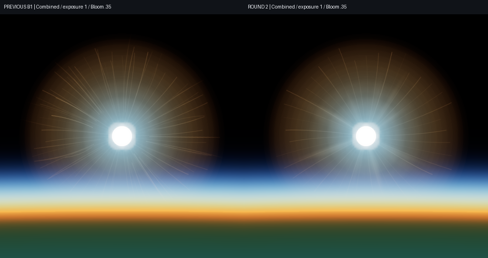
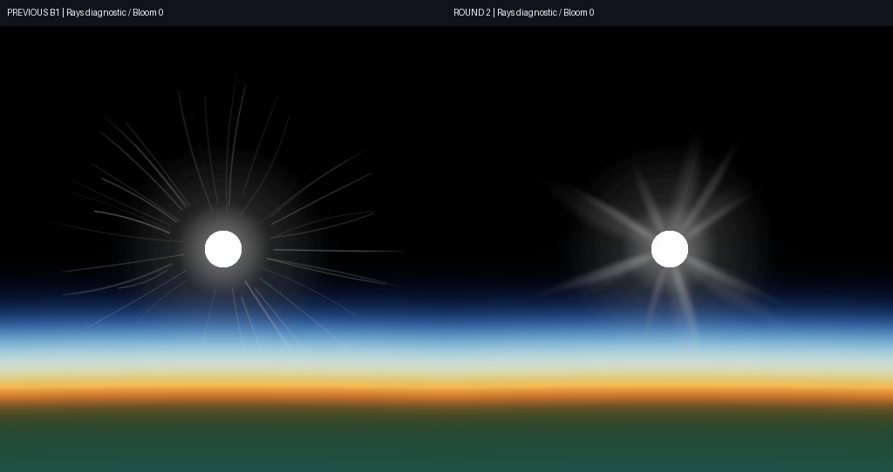
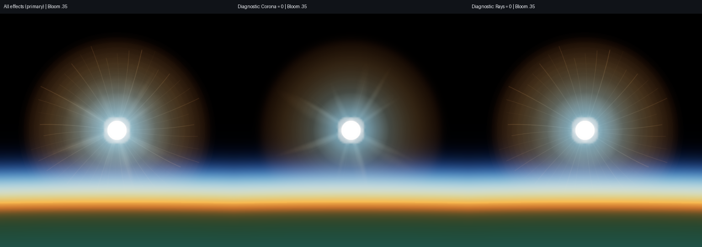
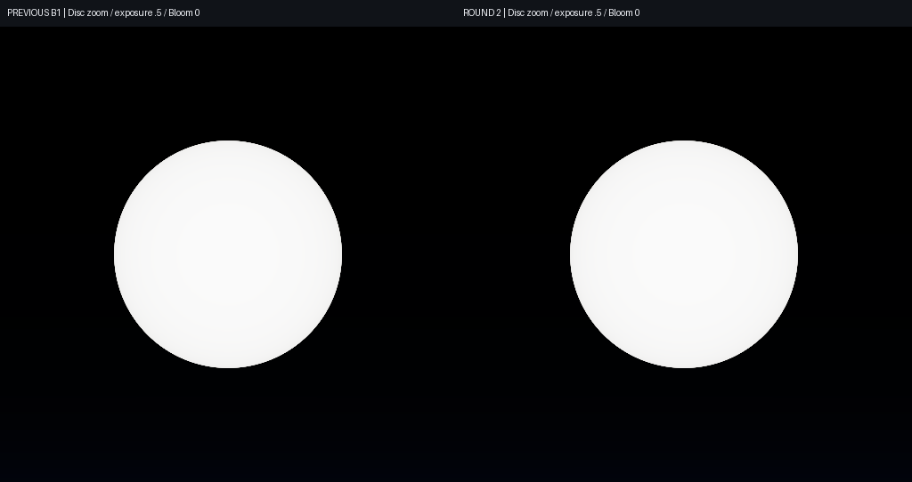
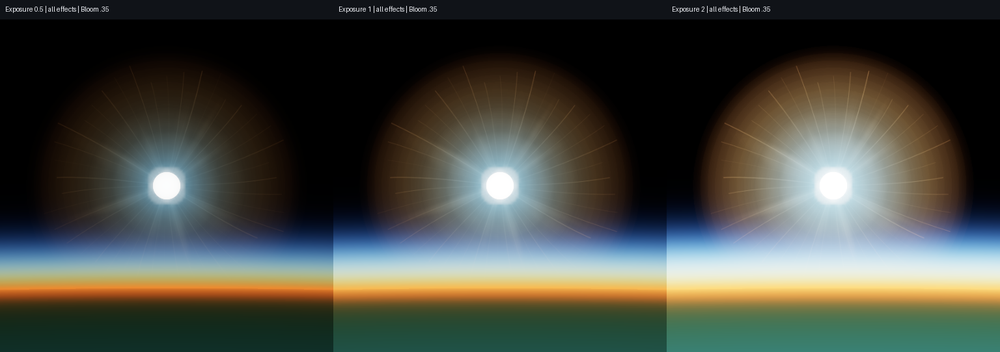

# B1 round two: controlled visual evidence

**Runtime and scoped implementation delivered; user visual acceptance remains open.** The revised Rays are softer and their roots join the disc neighborhood. The normal all-effects image still contains thin radial spokes from the unchanged Corona layer. This evidence does **not** close the overall B1 visual gate or authorize B2.

## Source and environment

| Item | Recorded value |
| --- | --- |
| Main at restoration | `5cb8eda655314119fa5567e1b4c023e2c4217906` |
| Previous B1 publication | `f92e2a3f769a3bf64a28626496a20142d27020d9` |
| Previous B1 runtime | Identical production source to `59f6089bfa63212f74a2913c6d11a6d13ec0a5d9` |
| Tested round-two source | `274d9397300b09843d2e3b517a55ed634b94639c`, clean working tree |
| Served bundle SHA-256 | `1d3fb59e72d2c816e8644657f42fa82cb62f4cb899a9eb3eee95a23371e3c074` |
| Browser | Headed Playwright Chromium 156.0.8078.4 |
| WebGPU adapter | Intel / xe-lpg, `isFallbackAdapter: false` |
| Capture time | 2026-11-03 13:27:41–13:28:56 UTC; exact times in raw reports |
| Scene time | Static comparisons: 2026-03-20T12:00:00Z; dynamic per-frame times in sidecars |
| Publication | A later evidence/documentation commit contains these files; it is not the runtime commit above |

[Verification commands, times and exit codes](verification.json) and each suite's `result.json` retain the actual tested source, clean status and bundle identity. No old runtime checkpoint has been relabeled as a newly tested HEAD. Build/lint logs in `precommit/` were produced before the runtime commit on the same candidate content; they are labeled separately.

The **before** images are fresh real WebGPU captures of the exact previous B1 Sun WGSL and solar GPU payloads replayed in the same verified host bundle. The capture guard checks that production changes since previous B1 are confined to the allowed Sun/Rays files, and verifies previous B1 production source equals `59f6089`. This is source replay, not a separately rebuilt historical binary. The after images use the committed candidate. Each image's `provenance` records effective runtime, host runtime, bundle hash, shader hash, source/payload hashes and capture-harness hashes. Both paths render to the actual canvas; no source image is fabricated or composited. The two unchanged older harness files use Windows CRLF in the checkout: their recorded hashes match the executed disk bytes, and CRLF-to-LF normalization matches the committed blobs. The two new round-two harness files and all recorded shader/source/payload bytes match directly.

## Read the primary comparisons first

The paired review PNGs are native-resolution 512×512 crops, left previous B1 and right round two. Labels occupy an additional strip outside the source pixels. No resizing, recoloring, exposure correction or sharpening was applied. Original full canvas PNGs and matching JSON sidecars in `comparison/before/` and `comparison/after/` are authoritative.

### Normal all-effects composition



[Previous full 1920×1080 canvas](comparison/before/combined-low-1080-e1.png) · [Round-two full canvas](comparison/after/combined-low-1080-e1.png) · [60° normal-FOV before](comparison/before/combined-normal60-1080-e1.png) · [60° normal-FOV after](comparison/after/combined-normal60-1080-e1.png)

Observation: the central Rays contribution is softer, with fewer detached bright strokes and more varied widths. **Thin long spokes remain plainly visible in the full composition.** The all-effects appearance is still not sufficient evidence to close visual acceptance.

### Rays diagnostic



[Previous full canvas](comparison/before/rays-low-1080-e1.png) · [Round-two full canvas](comparison/after/rays-low-1080-e1.png)

This diagnostic retains the physical disc and existing analytic glow but disables Halo, Corona, Tint and Bloom. The new irregular beams feather into the disc neighborhood, vary in width/reach/intensity and fade at different distances. The original detached constant-width segments no longer dominate this layer. A small number of fine accents remain intentional.

### Layer attribution: the remaining spokes



All three use the same camera, scene time, exposure 1, resolution and Bloom 0.35. Only the labeled layer is disabled. Removing Corona removes the conspicuous thin spokes; removing Rays leaves them. The before/after Rays-off PNGs are byte-identical. Together with the unchanged Corona asset, this locates the remaining pattern outside this round's B02 changes. These are explicitly labeled diagnostics, not alternative primary acceptance images.

No Corona, Halo or Bloom parameter was increased or suppressed in the primary images. Further removal of this particular spoke pattern requires B04 work; the conspicuous round golden outer halo is a B03 observation. Neither was implemented here.

### Disc and exposure





B01's normalized profile, warm-white edge, physical radius and AA are unchanged. All six disc-only before/after pairs are byte-identical. At diagnostic zoom and lower exposure the center-to-edge transition is mild and continuous. At normal size it is subtle, and exposure 2 remains close to a white disc. No yellow/orange core, exaggerated dark rim or arbitrary minimum RGB difference was introduced. Numerical energy checks support the physical constraint; they do not establish visual sufficiency.

## Capture controls and historical correction

The static fixture uses ready native ellipsoid terrain with no imagery, physical Sun and atmosphere, Moon/stars disabled, resolution scale 1 and matching viewport/canvas dimensions. Per-image sidecars record actual camera position/direction/up/right/FOV, time, controls, provider, tile readiness, solar-asset readiness, render/provider errors and projected solar geometry.

| Capture family | Rays | Soft / wide Halo | Corona | Tint | Bloom | FOV |
| --- | ---: | ---: | ---: | ---: | ---: | ---: |
| Primary combined | 1 | 1 / 1 | 1 | 1 | 0.35 | 24°, plus labeled 60° view |
| Disc diagnostic | 0 | 0 / 0 | 0 | 0 | 0 | 24°, plus labeled 4° zoom |
| Rays diagnostic | 1 | 0 / 0 | 0 | 0 | 0 | 24° |
| Corona-off diagnostic | 1 | 1 / 1 | 0 | 1 | 0.35 | 24° |
| Rays-off diagnostic | 0 | 1 / 1 | 1 | 1 | 0.35 | 24° |

Combined off-axis only changes orientation (yaw 0.09 radians; camera origin unchanged). Combined 720p only changes viewport/canvas size. Exposure pairs only change exposure. Every image resets the complete state independently; tests exercise the actual reset function and reject inherited Bloom/camera state. [All 18 before/after state checks](comparison/matched-state.json) pass; the [full-canvas comparison index](comparison/index.md) links every PNG and sidecar. The low/high views use heights 400,000 / 35,786,000 m; the limb view is separately labeled.

**Historical correction:** the initial B1 capture sequence's off-axis image also disabled Bloom, and its following 720p image inherited Bloom 0. Those older files remain preserved, but they must not be treated as strict position-only or resolution-only comparisons. This directory supplies the corrected controls. The older implementation report's general comparison wording does not override the actual historical settings.

## Dynamic visual evidence

[Lossless animated solar-region sequence](comparison/review/motion-sun-region.webp) · [Derivative method and all 160 source hashes](comparison/review/derivatives.json) · [First raw frame](comparison/after/motion-000.png) · [Last raw frame](comparison/after/motion-159.png)

- Frames 000–119: 120 consecutive saved renderer frames, moving the physical solar projection with camera and scene time; fixed exposure 1 and 1920×1080.
- Frame 120: deliberate high-orbit-to-limb reset. Its renderer frame ID advances by 17, including 16 unsaved setup/settling frames. This is **not** a claim of 160 uninterrupted renderer frames.
- Frames 120–159: 40 newly rendered limb samples through partial and full hiding; exposure changes at 128, 136 and 152, resize at 144. All intentional changes are marked in each sidecar and in the animation.
- Motion frames 131 and 132 record `tilesLoaded: false` during the moving limb view; solar assets remain loaded and render/provider errors are empty. Static comparisons are settled and ready. No terrain-readiness claim is made for every moving frame.
- Playback is 10 fps for inspection, not measured render throughput. The crops follow the recorded Sun projection without rescaling; a 720p Sun therefore becomes smaller at the marked resize.
- Manual review inspected all eight sequential contact sheets, every saved frame's solar region, the full static canvases and key raw occlusion captures. No obvious new local flicker, swimming or spontaneous pop was observed in these bounded sequences. Exposure/resize changes and the scene reset are deliberate. The surviving Corona spokes remain visible.
- The solar-tangent-aligned local metric has 1,536 samples per frame, 119 steady transitions, maximum mean delta 0.001270625 and maximum p99 delta 0.012145284. Three stationary repeats have zero local difference. These are supporting diagnostics, **not** proof from a whole-image mean and not a substitute for visual inspection.

[000–019](comparison/review/motion-contact-000-019.png) · [020–039](comparison/review/motion-contact-020-039.png) · [040–059](comparison/review/motion-contact-040-059.png) · [060–079](comparison/review/motion-contact-060-079.png) · [080–099](comparison/review/motion-contact-080-099.png) · [100–119](comparison/review/motion-contact-100-119.png) · [120–139](comparison/review/motion-contact-120-139.png) · [140–159](comparison/review/motion-contact-140-159.png)

## Occlusion and lifecycle evidence

| Check | Evidence and observation |
| --- | --- |
| Partial Earth occultation | [Half-disc original](occlusion/limb-0.png); visible energy declines through the five recorded limb positions |
| Full Earth occultation | [Fully hidden original](occlusion/limb--1.5.png); Sun-on/off changed pixels 0, energy 0, blocked-pixel maximum 0 |
| Actual mesh terrain | [Mountain original](occlusion/real-mountain-occluder.png) and [removed-mountain control](occlusion/mountain-removed.png); actual mesh hit with analytic Earth miss at the center; center RGB delta [0,0,0] while covered and [255,255,255] after removal |
| Terrain limitation | The mountain image is partial disc coverage, not an assertion the whole source is hidden. This uses the existing real heightmap mesh fixture; no new live global-terrain service test is claimed |
| Physical direction/size/photometry | [Existing Sun regression](sun/result.json), [4096-sample production-WGSL integration](physics-motion/result.json): mean 4.994052866 vs 5, error 0.1189427%; radius 0.00465 rad |
| Resource reuse | Physics/motion: 0 new steady textures/buffers, existing solar assets reused, native creation/destruction 32/32 |
| Resize / device loss / rebuild | [Existing visual/lifecycle suite](visual-lifecycle/result.json): resize, intentional loss with one expected error, stopped loop, zero post-notification Bloom counter increments, three recreated scenes without errors |
| Native teardown | Visual/lifecycle native resources 6844 created / 6844 destroyed, live list empty |

The device-loss counters describe CPU-side renderer accounting, not proof of whether an already submitted GPU frame executed. The fresh run records zero in-flight counter increments too; older transition observations remain historical.

## Automated checks, separately from visual review

All six groups in [verification.json](verification.json) returned exit 0 on clean `274d939`: 11 focused Node tests; controlled before/after capture; B1 physics/motion; solar occlusion; existing Sun; existing M2.6 solar visual/lifecycle. Browser error arrays are empty except the deliberately induced device-loss error recorded inside that test. The existing builder generated the three R8 payloads, all five non-Rays payload hashes stayed unchanged, the candidate built, and normal lint/commit hooks passed.

The unchanged GPU budget is three 512×512 R8 ray payloads (786,432 bytes), 2,883,584 bytes for all solar payloads, three Rays texture samples and eight solar samples total; no added pass. Existing visual-suite GPU timestamps for this candidate show all-enabled five-pass sum p50 9.764864 ms / p95 11.796480 ms, distinct from CPU wall/map time. This is not a previous-B1 performance comparison or a speed-up claim.

No manual Full dispatch/rerun, `ci:full` toggle or new complete WebGL differential was performed. The authorized publication push updates the existing ready PR, so its normal automatic Fast and non-rendering Full gates apply. Their exact publication HEAD and final outcomes are recorded on PR #21, separately from the hardware runtime above. Full is not a rendering or user-visual acceptance result.

## Reproduction

On a clean checkout with the existing dependencies, build using the existing scripts and serve the repository at `http://127.0.0.1:8090/`. Keep the previous B1 commits available to Git. Set a **new, nonexistent** output path.

```powershell
$env:M0_GPU_MODE = 'hardware'
$env:M0_HEADLESS = '0'
$env:M0_REQUIRE_PHYSICAL_GPU = '1'
$env:M1_BASE_URL = 'http://127.0.0.1:8090/'
$env:M1_OUTPUT = 'Build/B1-round2-new/comparison'
node coordination/ci/m2-b1-round2-capture.mjs
```

Exact additional commands are in `verification.json`; assign separate output directories for each browser suite. The harness rejects output-directory reuse, non-B1 production differences, mismatched served WGSL, unready static captures and unequal comparison controls.

## Handoff

B01/B02 scoped refinement and evidence are complete. Remaining thin Corona spokes, round Halo shape and weak high-exposure disc differentiation are explicitly visible limitations, not silently waived criteria. User visual acceptance is pending. No PR merge, main push, B03–B07, B2/B3, M2.7 or M3 work is authorized by this handoff.
