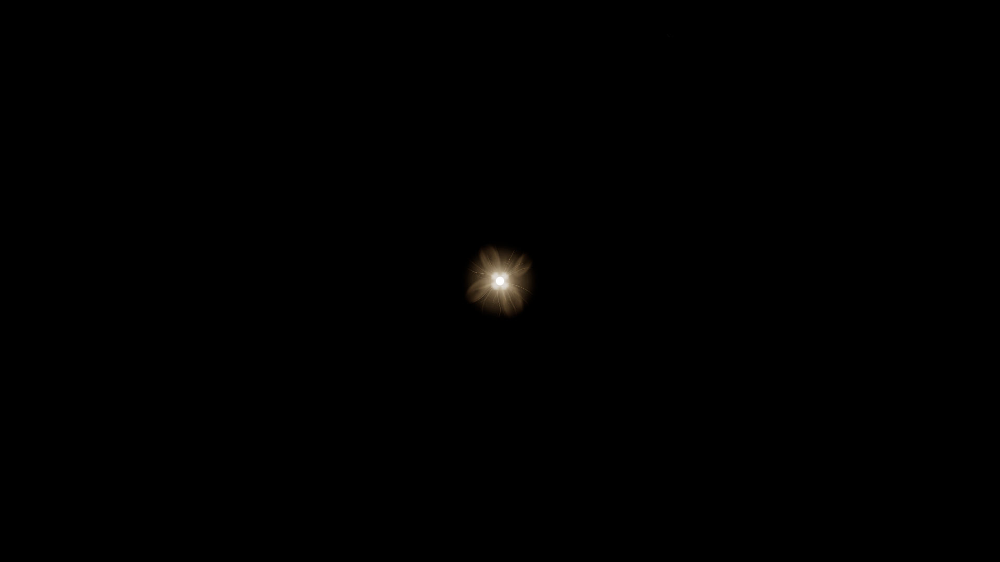
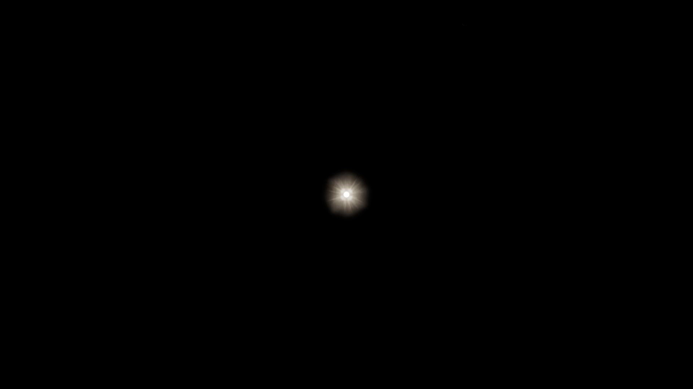

# M2.6.1-B2 round two — matched hardware evidence

**Technical result: PASS. User visual acceptance: PENDING_USER_REVIEW.**

This is B03 Halo retention/combination verification and B04 Corona refinement only. B1 disk/rays remain user-accepted. B3 Bloom, B4 atmospheric integration, B5 integrated acceptance and later milestones are not started.

## Source and environment

| Item | Before | After |
| --- | --- | --- |
| Runtime checkout commit | `302682b41a9e0ec64fcda1a0621dc49205eb694d` | `b5fc33e37e0a8f5faeb731df23c954cb86f36dd0` |
| Working-tree status at capture | Only the two new capture entry points were untracked; runtime and assets unchanged | Clean |
| Bundle SHA256 | `c60f33511ced8e09c0fa1b9e77dc410f4fae28b2e5a5f47db947524916ace236` | `504a8b4ae55497191400a1e4208c577473c414b74b18ec4adcf61ef42e40b99e` |
| Static / extended images | 16 / 142 | 16 / 142 |
| Browser / adapter | Chrome 156.0.8078.76; Intel Xe-LPG; fallback false | Identical |
| Host GPU / driver | Intel Arc 130T; 32.0.101.8801 | Identical |
| Drawing buffers / DPR | 1920×1080 and actual resize to 1280×720; DPR 1 | Identical |

Capture times are in UTC in the raw reports; the task date is 2026-11-04 in Asia/Shanghai. Hardware runs used the isolated Windows worktree `D:\github\cesium-webgpu-globe-b2-round2`. The user's initial checkout was `D:\github\cesium-webgpu-globe`; the historical `D:\cesium-webgpu-globe` was not used. Runtime implementation is commit [e009078](https://github.com/pp123pp/cesium-webgpu-globe/commit/e009078aa836e2631e8ec8566aa30255363ee6e1); tested commit [b5fc33e](https://github.com/pp123pp/cesium-webgpu-globe/commit/b5fc33e37e0a8f5faeb731df23c954cb86f36dd0) adds roadmap formatting only. Subsequent evidence/status commits do not change runtime inputs. The playback HTML and its generator template receive only an ESLint-required else-block brace fix after capture; raw PNGs, JSON, configuration and recorded capture-script hashes remain unchanged.

The [audit](audit.json) verifies every raw PNG against its recorded SHA256 and compares **158 matching scene pairs**. Camera, time, projection, exposure, dimensions/DPR, all controls, providers, browser and adapter match; numerical state comparison permits only 1e-10 absolute roundoff and retains all original values. Before/after capture-helper hashes differ only because an explicit Node `URL` import was added for ESLint; capture configuration and behavior did not change. The extended baseline rerun already uses the same camera roundoff criterion as the final run.

## What changed

- The fine Corona replaces 18 fixed-width stroke paths with 26 filled, tapered, feathered density envelopes. Width, longitudinal opacity, root, reach and end falloff vary deterministically; fine structure stays subordinate to broad energy.
- Broad Corona replaces hollow ellipse rims and ribbon strokes with 15 overlapping, unequal density distributions. Unequal angular clusters, lengths and strengths break complete petals while preserving strong and quiet directions.
- `coordination/ci/generate-corona-artwork.mjs` regenerates the two editable SVGs. The existing Chromium `build-solar-textures` pipeline still produces two 512² R8 payloads and the manifest.
- Corona-only tint is mixed 72% toward its own linear Rec.709 luminance before atmospheric transport. This reduces the brown-gold veil while preserving that layer's pre-transport luminance; it does not claim identical final tone-mapped brightness.
- Halo assets, Halo falloff, physical disk, B1 Rays, angular support, glow strength, atmospheric transport, visibility/depth and Bloom implementation remain unchanged. No per-frame random input is introduced.

Nine solar textures still total **3,145,728 payload bytes**. There are no new textures, bindings, samples or render passes. The shader adds only one dot product and color mix for Corona.

## Normal full-effect comparison

Every independent capture explicitly resets the complete state. Full means Solar Disc on; Rays / Soft Halo / Wide Halo / Corona / Tint all **1**; Bloom **0.35**; atmosphere, globe, Moon and stars enabled. Normal captures use FOV **60°**, camera height approximately **400 km**, Sun elevation **60°**, time **2026-03-20T12:00:00Z**, exposure as named, and an off-axis yaw of 15° where named. The fixed physical angular radius is 0.00465 radians, glow radius 0.05 and glow strength 0.08. Existing Bloom uses a linear-HDR threshold of 1.0 before 4×4 downsampling, one quarter-resolution diagonal blur (center weight 0.36; four diagonal weights 0.16 at ±2 texels), then strength 0.35 composition before the single ACES/sRGB stage. These shader constants and source hashes are unchanged; Bloom buffers are 480×270 or 320×180.

The normal scene looks toward the Sun, so Earth need not be in the frame. Earth/atmosphere remain active and are visible in the separate orbital/limb scenes. Providers are `EllipsoidTerrainProvider` and local `TileMapServiceImageryProvider` / NaturalEarthII. The real-mountain pair explicitly replaces the terrain provider with the existing Gaussian heightmap mesh fixture. All captured settled scenes report complete tiles, no pending-resource failure and all 9 solar assets LOADED.

| Full-effect scene | Before | After |
| --- | --- | --- |
| 60° centered, exposure 0.5 | [Original PNG](before/normal-60-centered-exposure-0.5.png) | [Original PNG](after/normal-60-centered-exposure-0.5.png) |
| 60° centered, exposure 1 | [Original PNG](before/normal-60-centered-exposure-1.png) | [Original PNG](after/normal-60-centered-exposure-1.png) |
| 60° centered, exposure 2 | [Original PNG](before/normal-60-centered-exposure-2.png) | [Original PNG](after/normal-60-centered-exposure-2.png) |
| 60° off-axis, exposure 0.5 | [Original PNG](before/normal-60-offaxis-exposure-0.5.png) | [Original PNG](after/normal-60-offaxis-exposure-0.5.png) |
| 60° off-axis, exposure 1 | [Original PNG](before/normal-60-offaxis-exposure-1.png) | [Original PNG](after/normal-60-offaxis-exposure-1.png) |
| 60° off-axis, exposure 2 | [Original PNG](before/normal-60-offaxis-exposure-2.png) | [Original PNG](after/normal-60-offaxis-exposure-2.png) |
| Actual 1280×720 resize | [Original PNG](before/actual-resize-1280x720-full.png) | [Original PNG](after/actual-resize-1280x720-full.png) |
| Restored 1920×1080 | [Original PNG](before/actual-resize-restored-1920x1080-full.png) | [Original PNG](after/actual-resize-restored-1920x1080-full.png) |

These are complete, unedited WebGPU canvas images. No generated, composited or beautified image substitutes for the runtime output.

## Layer attribution and 12° diagnostics

All rows below use 1920×1080, DPR 1, exposure 1 and the same time/position; only the listed controls change. The physical disk remains enabled in each diagnostic. Gray untinted single-layer images are not final-color judgments.

| Diagnostic | Rays | Soft / Wide Halo | Corona | Tint | Bloom | Before / after |
| --- | --- | --- | --- | --- | --- | --- |
| Halo-only | 0 | 1 / 1 | 0 | 0 | 0 | [Before](before/diagnostic-12-halo-only.png) / [After](after/diagnostic-12-halo-only.png) |
| Corona-only | 0 | 0 / 0 | 1 | 0 | 0 | [Before](before/diagnostic-12-corona-only.png) / [After](after/diagnostic-12-corona-only.png) |
| Halo + Corona | 0 | 1 / 1 | 1 | 1 | 0 | [Before](before/diagnostic-12-halo-corona.png) / [After](after/diagnostic-12-halo-corona.png) |
| Full | 1 | 1 / 1 | 1 | 1 | 0.35 | [Before](before/diagnostic-12-full.png) / [After](after/diagnostic-12-full.png) |
| Corona-off | 1 | 1 / 1 | 0 | 1 | 0.35 | [Before](before/diagnostic-12-corona-off.png) / [After](after/diagnostic-12-corona-off.png) |
| Halo-off | 1 | 0 / 0 | 1 | 1 | 0.35 | [Before](before/diagnostic-12-halo-off.png) / [After](after/diagnostic-12-halo-off.png) |
| Bloom-off | 1 | 1 / 1 | 1 | 1 | 0 | [Before](before/diagnostic-12-bloom-off.png) / [After](after/diagnostic-12-bloom-off.png) |

Halo-only is byte-identical before/after (SHA256 `d659df4f2aa50ab02b31fb96c4fd8e7678a89a0af43988cfda8fc8cc51444dca`). Corona-off is also byte-identical (`a27326b1291766c1bc82ff9e2187883fba6f07137948cc7f28d99075529fcd4f`). This directly supports preservation of the matched Halo/disk/Rays/Bloom configuration; it is not a universal no-regression claim.

Corona-only retains the existing masked inner gap. Halo fills that region in Halo + Corona and full images; it is not counted as a new black-ring defect. Rays are disabled in Corona-only, so its old thin lines are attributed to Corona.

## Visual judgment and exposure

The implementation review and an independent visual review find a visible reduction in traceable fine curves, stable-width contours and defined endpoints. The old upper-right/lower-left elliptical rims no longer read as detached leaves. Fine brightness sits within broad, unequal plumes; the normal full-effect view shows the improvement as well as the 12° diagnostic.

Halo's continuous inner/middle/outer falloff is preserved, with no observed hard ring, rectangular boundary or new banding. The disk and inner light remain distinct. Full output is predominantly white/warm-white, with restrained peripheral gold.

| Centered exposure | Any channel ≥254, before | After | Interpretation |
| --- | --- | --- | --- |
| 0.5 | 0% | 0% | Lower energy; bright disk and soft structure remain readable |
| 1 | 0.007137% | 0.007137% | Normal balance; bright core and black space retained |
| 2 | 0.009066% | 0.009066% | Bounded bright core; inner detail is compressed |

The clipping statistic covers the whole 1920×1080 canvas and is not a solar-ROI quality score. After mean displayed luminance increases slightly because energy is redistributed and color is less saturated; this is not a blanket suppression of all detail. At 12° the broad Corona still looks soft and somewhat cloud-like. At 60° fine structure becomes a compact soft starburst. Those are remaining artistic limits for user review, not a physical plasma simulation.

## Resolution, motion and occlusion

[Before extended raw report](before-extended/result.json) and [after extended raw report](after-extended/result.json) retain all scene states, measurements and images.

- Actual resize reaches 1280×720 and returns to 1920×1080, including matching buffer/Bloom dimensions. No observed new sampling jump or unstable shape.
- Fixed 60° and 12° states each have four byte-identical repeats before and after.
- Both continuous sequences retain all **120 consecutive render frames**, with no frame-number gaps and an identical 20-frame fixed prefix. View [before playback](before-extended/continuous/index.html), [after playback](after-extended/continuous/index.html) or [ordered after frames and manifest](after-extended/continuous/sequence.json). Open the HTML with its adjacent PNG files; GitHub's source view does not execute the player.
- Frames 0–19 are fixed; 20–49 rotate the camera by 0.05° per frame; 50–79 advance native time 10 seconds per frame; 80–99 intentionally ramp exposure 1→2; frame 100 resets exposure to 1 and resizes to 1280×720; frame 110 restores 1920×1080. Every transition is labeled. These paced captures are inspectable temporal evidence, **not real-time FPS**.
- The largest mean RGB frame difference after is 0.00009939 (normalized 0–1), versus 0.00013321 before. This descriptive metric and inspected frames reveal no new obvious flicker/shape jump; they are not universal temporal certification.
- High/low orbit, orbital sunrise/limb and low-Sun cases retain normal atmosphere and background effects. See [high orbit](after-extended/high-orbit-sunrise-limb.png), [low orbit](after-extended/low-orbit-sunrise-limb.png) and [near ground](after-extended/near-ground-low-sun.png).

| Occlusion check | Final observed result |
| --- | --- |
| Independent WGS84 hidden-pixel mask, five limb positions | Maximum blocked RGB difference 0 in all cases; explicit two-pixel grazing uncertainty band retained |
| Visible → partial → fully hidden | Energy 12,836,382 → 4,688,049 → 0; fully hidden changed-pixel count 0 |
| Actual heightmap mesh blocker | Analytic Earth miss; actual globe mesh hit; nonzero GPU depth; Sun center RGB difference [0, 0, 0] |
| Same camera/time, blocker removed | Center RGB difference [42, 63, 5]; solar source returns |
| Mountain pair identity | Position/projection/time/layers/Bloom equal; basis delta 1.11e-16 within 32×Number.EPSILON |

View [partial Earth occlusion](after-extended/earth-occultation-0.png), [fully Earth-hidden Sun](after-extended/earth-occultation--1.5.png), [real mesh blocker](after-extended/real-mountain-occluder.png) and [blocker removed](after-extended/real-mountain-removed.png).

The near-ground low-Sun image retains a strong yellow/orange sky, coarse blue surface and visible imagery seams; it does not establish that the overall Earth scene is fully natural. The high-orbit image named `high-orbit-sunrise-limb` does not show a clearly discernible Earth edge and is used only for high-orbit Sun appearance. Low-orbit and explicit Earth-mask images provide the visible limb/occlusion evidence. These background limitations are not attributed to the B2 Corona without a demonstrated regression.

## GPU cost and resource behavior

These are GPU timestamp-query measurements at the same full 60° scene, 1920×1080, 30 samples per mode after six warmup iterations. Render-pass sums are distinct from CPU render/map waiting time.

| Matched run | Before mean / p95 | After mean / p95 | Passes |
| --- | --- | --- | --- |
| Static matrix, full effects | 2.412 / 3.146 ms | 2.272 / 2.556 ms | 5 → 5 |
| Extended run, restored same full state | 2.283 / 2.490 ms | 2.368 / 2.621 ms | 5 → 5 |

The two observations span normal run-to-run variation, not a speedup claim. No renderer texture or buffer allocation occurs during these measurements. No extra texture/sample/pass is introduced; physical resident VRAM remains unmeasured.

[404 fallback](resource-fallback-404/result.json) and [corrupt-payload fallback](resource-fallback-corrupt/result.json) both pass on the clean final runtime. The ninth, last-loaded tint resource is deliberately failed after both Corona payloads have uploaded: all eight partial allocations are released and nine neutral textures are created. After viewer destruction, the solar/atmosphere renderer counters balance **20/20 textures and 3/3 buffers**; these are not whole-engine native-allocation totals. The single expected HTTP 404 console error is retained in that deliberate failure test; it is not hidden or counted as a clean visual run.

The four normal before/after capture suites have zero browser errors, warning/error console messages, request failures, provider errors, render/GPU errors or shader compilation errors. All 9 solar assets load. This statement does not reinterpret HTTP 404 injection as error-free.

## Engineering checks and scope of evidence

| Check | Result / evidence |
| --- | --- |
| Existing solar texture generation | PASS; [payload generation log](logs/b2-final-payloads.log); only two Corona payloads and manifest change |
| Focused B1/B2, assets and lifecycle units | 9/9 PASS on the stabilized candidate; [TAP log](logs/b2-focused-tests.log); later runtime changes were comment-only |
| Targeted ESLint | PASS; [log](logs/b2-eslint-final.log); explicit Node URL import fixes the earlier harness lint error |
| Final clean-source bundle build | PASS; [log](logs/b2-clean-source-build.log); served bundle and payload hashes equal the tested checkout |
| Generated declarations / engine types | PASS; [generation log](logs/b2-types-generated-final.log), [engine type log](logs/b2-types-engine-final.log) |
| Final hardware static / extended | PASS; [static report](after/result.json), [extended report](after-extended/result.json) |
| Hardware asset fallback / destruction | Both PASS; reports linked above |
| Published-head CI | [PR #22 checks](https://github.com/pp123pp/cesium-webgpu-globe/pull/22/checks); exact Fast/Full run links and final head are recorded in the PR delivery summary |

The B2 unit file is renamed to `m2-b2-halo-corona.test.mjs` so the existing CI `m2-*.test.mjs` glob executes it. Existing assertions remain, with additional edge-feathering and directional-energy coverage. The old fallback test's 8/7 counts are corrected to the actual B2 9/8 allocation sequence; lifetime balance assertions remain strict.

The new Windows worktree initially lacked generated core declarations. The first `build-ts` then exposed an unchanged upstream LF-only parser reading a CRLF shim candidate list. Converting that one local input's line endings to LF (no Git content change) allowed the normal generator and engine types to pass. No parser, type gate or engine source was changed to bypass this. Earlier failures and readable logs are retained; [log index](logs/index.json) records original PowerShell encodings and hashes.

Historical M2.6 device-loss/recreation and full WebGL differential evidence remain applicable to unchanged ownership/WebGL code, but were **not rerun locally as new B2 hardware results**. This round newly checks async cancellation/idempotence/upload failure through focused units and 404/corrupt teardown on hardware. Long-duration soak, new device-loss/recreation stress, other GPUs/browsers and final M2.6.1 integrated acceptance remain outside this delivery. Automatic PR CI is not manually dispatched or disabled.

## Preserved attempts and review status

- [Initial extended baseline failure](attempts/before-extended-initial/error.json) retains its original report and all 141 raw frames. It failed exact JSON camera equality on a 1.11e-16 normalization change, not a rendering leak; the corrected before/after runs keep exact position/projection with a documented double-precision basis tolerance.
- [Candidate 1](attempts/candidate-1/result.json) removes outlines but still has excessive gold haze; it is retained as an intermediate, not the final acceptance candidate.
- [Candidate 2](attempts/candidate-2/result.json) is the reviewed visual state. Final clean-source captures reproduce that state; the last shader change only clarified its luminance-preservation comment.
- [Round-one originals](../round1/README.md) and the user's original review are preserved through the [B2 evidence index](../README.md).

**Handoff: B2 第二轮优化与技术验证完成，等待用户视觉验收。** No PR merge, main push or B3 implementation is part of this delivery.
