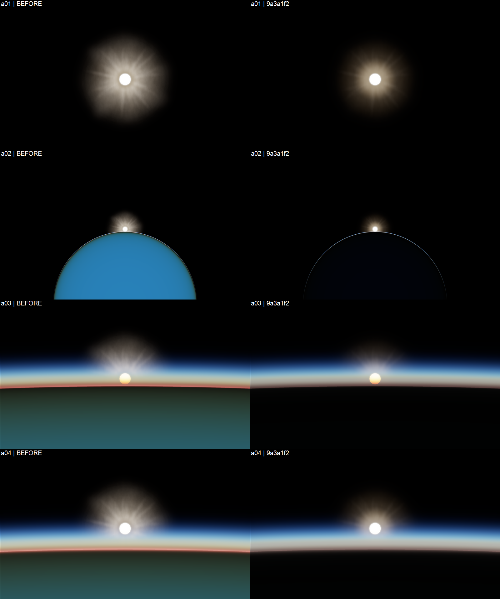
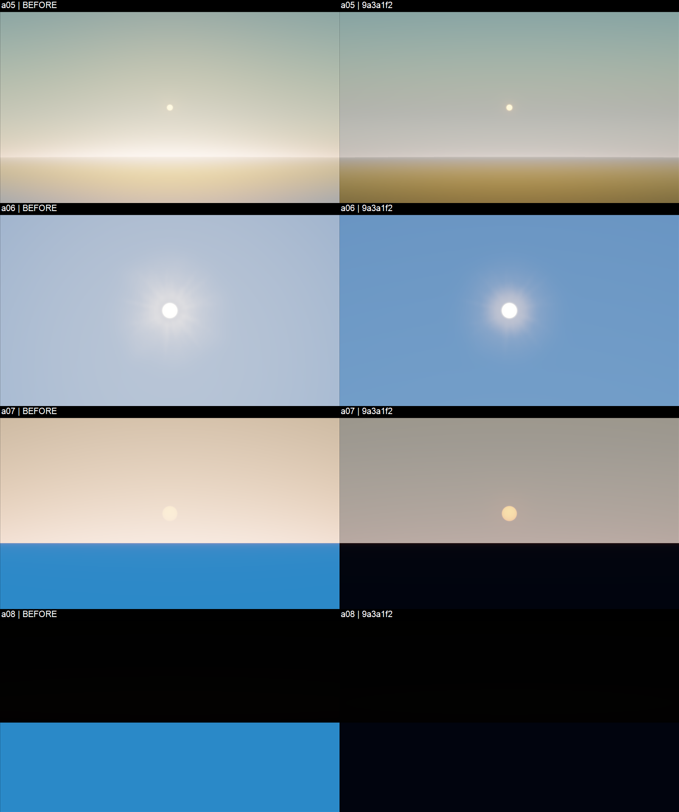

# B5-A-R 第三轮：夜侧照明与太阳静态修整

**最新状态（2026-11-04）：用户明确确认“视觉验收通过，合并到main”，B5-A 静态视觉验收通过并授权合并 PR #27。** A02 细亮边和 A05 雾感作为已知视觉限制保留，不宣称已消除。B5-B/B5-C 和 M2.6.1 整体关闭不在本次验收范围；实际合并状态以 PR #27 为准。

本次复核在干净发布提交 `885e6a3e9f52c6f8609164184a0414363f0130fb` 上重新采集 70 张截图，全部哈希与下述第三轮图像一致；运行源码、bundle 和浏览器生产 Shader 均未改变。Chrome 156.0.8078.80 / Intel Xe-LPG，浏览器错误和警告均为 0。后续 CI 修复只调整测试加载流程，不改变已接受的渲染效果。

以下保留第三轮实施时的证据、观察与限制；其中“待复核”描述由上述用户决定取代。

## 来源与可复现性

| 项目 | 实际记录 |
| --- | --- |
| 实现及干净采集提交 | `9a3a1f2decb1f4ec7d37ed3b5649496d007a23d4` |
| 采集时工作区 | `sourceStatus` 为空 |
| Bundle SHA-256 | `410f39366223a6a611e2072945c39d682507b2b152e2105a964325887cab9980` |
| 浏览器生产 Shader SHA-256 | `2258c916682dea891f86d5370774259189a0c66ebb899354b33654429073c81f` |
| 环境 | 有界面 Chrome 156.0.8078.80；Intel Xe-LPG；非软件回退 WebGPU |
| 截图 | 70 张原始 1920×1080 PNG，70/70 SHA-256 校验通过 |
| 资源与错误 | 9/9 太阳资源加载；浏览器错误 0，警告 0 |
| 清理 | 本次 Globe 统计的 6,882/6,882 buffers 释放；0 canvas、0 pending imagery requests |

原始报告为 [capture-result.json](capture-result.json)，摘要为 [summary.json](summary.json)。八个主要场景与此前 B5-A-R 证据的相机、时间、曝光 1.0 和分辨率逐项一致。A02、A03、A05、A06、A07 另有曝光 0.5 和 2.0 对照。旧证据未覆盖；本轮的技术 PASS 不等于视觉 PASS。

定位到一个本地构建身份问题：根目录 `node_modules/@cesium/core`、`engine`、`widgets` 曾指向旁边的旧工作树。仅修正这三个 junction 后重建；采集脚本现在同时比较浏览器实际加载的组合 Shader 与当前目录源码的 SHA-256，避免“本地 bundle 与服务 bundle 相同，但二者均来自错误工作树”的假阳性。

## 实际实现

地面颜色原来作为未受光的 albedo 直接参与合成，导致背光地表仍呈白天地面亮度。现在从真实深度重建地面位置和椭球法线，以太阳方向、Lambert 余弦及太阳到地面的透射率计算直射照明；再独立合成相机路径的空气透视。天空和大气入射散射不乘地面照明。

`globe.enableLighting` 控制表面照明。内部创建的 WebGPU 物理场景默认开启；显式 M1 无大气场景和调用者传入的 Globe 保持其设置。太阳强度 0/5/10/20 的表面响应、关闭光照恢复 albedo，以及隐藏太阳圆盘不改变物理照明均有实际浏览器覆盖。利用已有 uniform 保留字段，不增加纹理、buffer 或渲染 pass；大气关闭路径不依赖 LUT，保持冷启动可用。

按匹配参数实验，将 WebGPU 默认 Mie 散射/消光从 `3.996e-6 / 4.44e-6` 调整为 `1.998e-6 / 2.22e-6`，各向异性从 `0.8` 调整为 `0.65`，作为较清澈的默认气溶胶设置；运行时仍可设置原有浑浊介质。长路径的场景线性显示平衡降低饱和度和亮度，不改直接太阳圆盘的输运、深度遮挡及单次 ACES/sRGB 输出顺序。

逐层关闭证明远轨的强放射结构主要来自 Corona，而非单独的 Rays。保留两层原创 Corona 和三个 Rays 纹理，降低 Corona 强度、提高不规则细节层权重，并缩短 Rays 外缘。没有替换为预渲染整张太阳，也未加入镜头鬼影、污渍或夸张横向光条。

## 匹配画面结果

下表亮度为 sRGB 解码后的显示线性亮度，不是 HDR 辐射能量。圆盘对比是圆盘 ROI 平均亮度减去邻接环带 ROI 亮度。

| 指标 | 修复前 | 修复后 |
| --- | ---: | ---: |
| A08 夜侧地面亮度 | 0.225537 | 0.001250 |
| A07 黄昏地面亮度 | 0.226090 | 0.001326 |
| A07 圆盘与邻接天空对比 | 0.096206 | 0.346076 |
| A05 圆盘与邻接天空对比 | 0.276783 | 0.441082 |
| A01 圆盘与邻接环带对比 | 0.549678 | 0.749132 |

A07/A08 的新增门槛验证了取样区域具有真实地形深度。通用旧指标 `metrics.surface` 只是左下角 ROI；例如 A06 中该区域实际是天空，不能将其统称为“地面亮度”。原先试加的 A05 全画面 ROI 低亮度判据不能区分空气散射与材质照明，没有用它证明修复；最终门槛针对真实深度及独立下视地面照明测试。

预览图仅为原始截图缩放拼排；正式证据为 [captures](captures/) 中未修改的 PNG。

## 验证与结果边界

40/40 相关 Node 检查通过，定向 ESLint 和 `git diff --check` 通过。实现提交钩子的 ESLint、prettier、TypeScript `tsc` 和 Markdown 检查通过。修正了 B2 测试中钉死旧 Corona 混合比例的断言；纹理边缘跳变上限和数值能量范围未放宽。

五组硬件浏览器验证通过：M1 Globe、大气 8 组、太阳 8 组、星月 12 组、新增修复检查 10 组。太阳覆盖保留 `limb -0.6`、实际山体遮挡、完全隐藏后的光晕消失、冷启动和 resize。独立 CPU 像素参考模型同步表面照明与显示平衡；原有 ±3 通道容差、物理/深度/遮挡断言未降低。

[checks](checks/) 保留原始验证报告、四个行为缺陷的修复前失败和最终日志。五组浏览器报告来自随后提交为 `9a3a1f2` 的工作区，保留了其旧 HEAD 加工作区改动状态；提交钩子仅作格式化，不冒称这些是干净 HEAD 重跑。另一次 70 图采集则明确来自干净 `9a3a1f2`。最新发布提交的远端 CI 应以 GitHub 实际状态为准，不能沿用旧 `85ea6ad` 的成功状态。

## 尚未关闭的视觉意见与限制

A08 亮蓝夜侧地面的具体缺陷已在当前夹具中消除；A07 太阳对比及 A01 大团状日冕明显改善。A02 细亮边仍可见，曝光 2.0 更明显；A05 仍具有较强雾感和暖灰色天空。不能据此宣称全部静态视觉问题都已解决。A03/A04 的暖色与蓝色分层本身也不等于已证实的散射或深度错误。

表面使用椭球法线，不是每个山坡的精细法线照明，也未新增地形阴影贴图。`0.025` 是低强度艺术环境填充，不是经过物理标定的地球反照或完整间接辐照度。现有 RGB 大气仍不含臭氧和光谱转换；长路径平衡是显示校准，不应描述成物理输运修复。高曝光会提高地平线亮边和背景亮度、压缩圆盘对比，相关原图已保留。

未执行 B5-B 的 120 帧动态验收、B5-C 性能/完整生命周期认证、完整 WebGL differential 或手工 Full regression。上述清理计数不等于显存占用测量或多设备性能证明。下一步应复核本轮截图，继续处理未关闭的视觉意见，而不是直接关闭 B5 或合并 main。

## 参考实现与适配说明

参考 [Cesium GlobeFS](https://github.com/CesiumGS/cesium/blob/02ba4d6168ba4075ce524d022311e5daac972234/packages/engine/Source/Shaders/GlobeFS.glsl) 的表面受光与大气合成分离，及 [Bruneton 大气函数](https://ebruneton.github.io/precomputed_atmospheric_scattering/atmosphere/functions.glsl) 的地面直接辐照度形式：太阳辐照度乘透射率及非负法线余弦。也检查了 [Hillaire / UnrealEngineSkyAtmosphere](https://github.com/sebh/UnrealEngineSkyAtmosphere/blob/master/Resources/SkyAtmosphereCommon.hlsl) 的介质参数与 LUT 分离。

本轮是现有 WGSL 系统内的原创适配，没有复制上述引擎 shader、资产或完整大气管线。未声称移植完整 Unreal/Bruneton 算法，也未用参考引擎的质量作为本项目通过验收的替代证据。
