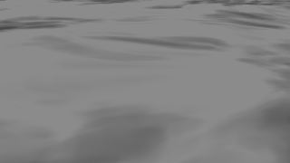
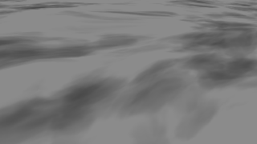
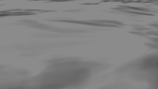

# M4 ellipsoid cloud shadows

The bounded WGS84 fixture looks down from 1,800 m at the equator, below the cloud base. Each pair renders the same scene and timestamp with only `scene.clouds.shadows` changed. The globe receives direct sunlight with a constant ambient floor. Both the shadowed and visible cloud paths use the M3 volume's active weather parameters, noise texture, and solar direction.

On Intel Xe-LPG, 38,724 of 57,600 pixels darkened with atmosphere off. No pixels brightened in the measured red channel. With atmosphere on, 38,228 pixels darkened in that channel. Shadow switching produced identical RGB output with zero coverage, hidden clouds, or disabled surface lighting. At 36 m/s over 90 seconds, moving the observer 3,240 m east recovered the shadow pattern: the mean absolute difference in the shadow signal fell from 17.36 to 0.73 display levels. The [WebGPU report](result.json) identifies the tested working tree, bundle, adapter, controls and cleanup. The [WebGL report](webgl-smoke.json) records three passing reference comparisons on the same bundle.

| Shadow off | Shadow on | 90 s later, same observer | 90 s later, observer moved with the wind |
| --- | --- | --- | --- |
|  |  |  |  |

To replay, build and serve the checkout, set `M1_BASE_URL` to its local URL and run `node coordination/ci/m4-ellipsoid-shadows-smoke.mjs` in a headed hardware browser. The fixture writes the report and matched PNGs to `Build/m4-ellipsoid-shadows`. Real terrain receivers and ambient attenuation belong to the next M4 step.

The [standalone demo](../../../../Apps/WebGPUCloudShadows.html) shows the Golden Gate Strait with satellite imagery, a ground close-up and a horizon view. The [screenshot](demo-timeline.png) shows the native Cesium Animation dial and Timeline bound to the scene clock. The [hardware interaction check](demo.json) covers dragging the timeline, playing and pausing with the dial, toggling shadows, and resetting the view.
