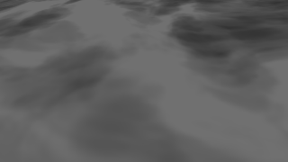
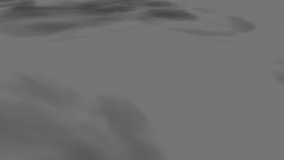
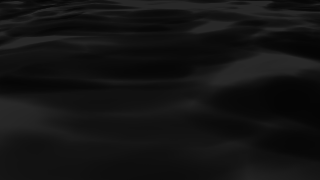
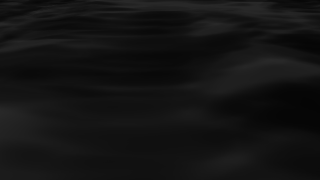
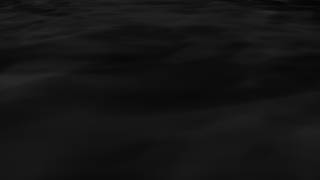
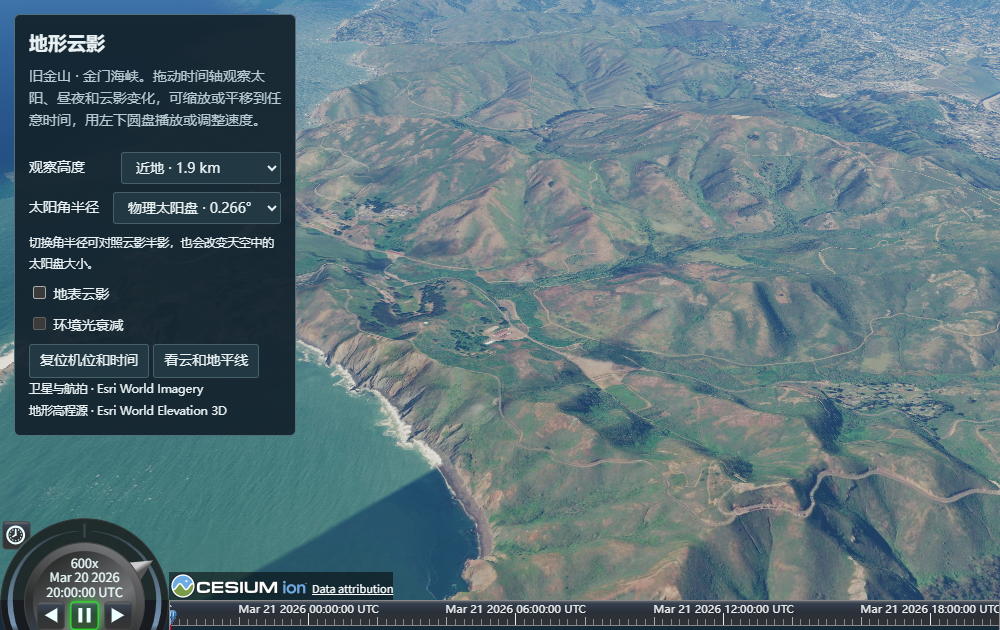
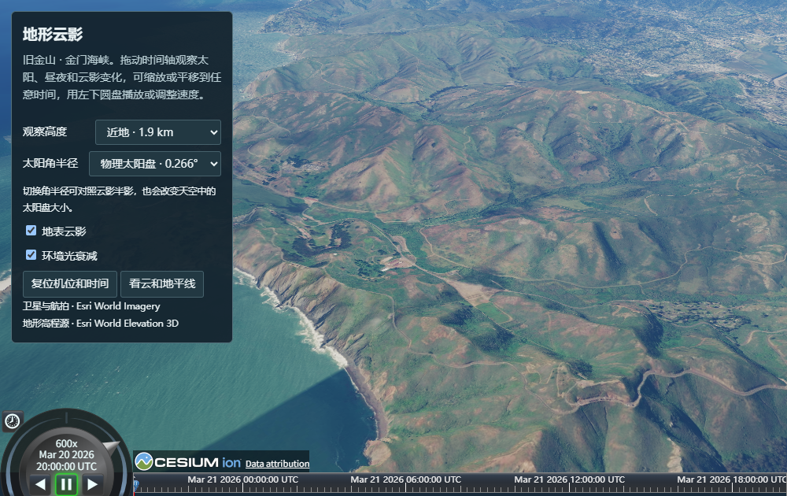
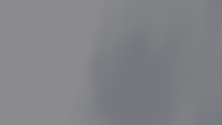
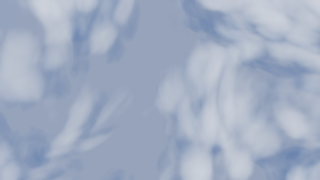
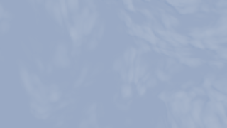

# M4 visual review and technical acceptance

The tested renderer is `89cb9a1b5faa99c5584cd166d1437e32da4996b7`, built from the reviewed main revision `d2833a1` plus the finite-disk shader change. Chromium 156.0.8078.4 reported a physical Intel Xe-LPG adapter. The served unminified Cesium bundle SHA-256 was `fd1fabcae758c494e7f457a2c2117ad9967c151f52bf6b65982e80cfe52bb412`. The reports retain the status of the working tree at capture. On 2026-11-06 the user explicitly accepted both A14 and A15, including the terrain attachment and motion of the cloud shadows and the direct/ambient dimming. M4 passed on this local branch.

## A14 — shadow attachment, motion and penumbra

At the same camera and cloud field, move the Sun from morning to afternoon. In each column the top frame has shadows off and the lower frame isolates direct attenuation. Compare the distribution over the terrain within each column. The normalized morning and afternoon shadow signals have a spatial correlation of 0.401. The [terrain fixture](terrain/result.json) also checks the L8 tile boundary and the receiver above the cloud top.

| Fixed clouds, morning | Fixed clouds, afternoon |
| --- | --- |
|  |  |
|  |  |

The complementary [wind test](ellipsoid/result.json) advances the clock 90 s. Shifting the observer 3,240 m east with the cloud reduces the mean shadow-signal difference from 17.65 to 0.72 display levels.

| Nearly point source | Physical Sun, 0.00465 rad | Enlarged Sun, 0.04 rad |
| --- | --- | --- |
|  |  |  |

At 9.35° solar elevation, the mean contrast on the same 7,202 point-source edges was 4.22, 1.44 and 1.25 display levels. The physical radius changed 24,708 of 27,176 sampled foreground pixels. The three angular samples approximate an emitting disk and average transmittance. The zenith ambient sample remains separate. The initial diagnostic used a hidden Sun, which selects a fixed radius. The passing test enables the Sun outside the view and checks the radius uploaded for each exposure.

## A15 — direct and ambient ground lighting

The Golden Gate demo uses Esri World Elevation 3D and World Imagery. Pause the clock and compare the same slope across the three captures. In the sampled live-image region, direct shadow darkened 221,875 pixels (maximum 48 RGB levels). Enabling ambient attenuation darkened another 104,176 pixels (maximum two levels). Neither comparison produced a brighter pixel. Restoring the checkboxes reproduced the original scene. The first live reset screenshot was taken before the view settled. The follow-up reproduced the original pixels after settling. [Live report](live/result.json) · [demo controls](live/controls.json).

| All shadows off | Direct only | Direct and ambient |
| --- | --- | --- |
|  |  |  |

## Altitude continuity

The [altitude report](altitude/result.json) covers 19 shadow on/off pairs. The ordinary lens looks from below the cloud base, inside the layer, above it and into orbit. A second series keeps a 20 km ground footprint at a fixed time and measures the mean RGB darkening. At 80 / 125 / 150 / 175 / 200 / 225 / 245 / 250 km it measured 2.12 / 1.91 / 1.57 / 0.96 / 0.32 / 0.07 / 0 / 0 display levels. Returning to 80 km restored 2.12. Natural views at 250, 300 and 4,500 km gave identical on/off output.

| 1.8 km | 4 km | 12 km | 175 km (fixed patch) | 4,500 km |
| --- | --- | --- | --- | --- |
|  |  |  |  |  |

## WebGL regression

The [three reference views](webgl/webgl-smoke.json) used the same candidate bundle. The complete differential ran both the pinned baseline `724b5db` and the candidate with the hardware D3D11 launcher on Intel Arc 130T. Each executed 3,822 WebGL specs. The baseline failed three, the candidate failed one, and the comparator reported zero new failures and zero tolerated pixel drifts. The shared failure was `Renderer/AutomaticUniforms — has czm_pass and czm_passOverlay`. Two baseline-only tileset timeouts passed on the candidate in this run. [Comparison](webgl/comparison.json) · [raw baseline](webgl/baseline.json.gz) · [raw candidate](webgl/candidate.json.gz).

## Reproduce

Build the candidate with `npm run build` and serve it locally. Set `M1_BASE_URL` to that server, then run the scripts in `coordination/ci`: `m4-terrain-shadows-smoke.mjs`, `m4-altitude-continuity.mjs` and `m4-ellipsoid-shadows-smoke.mjs`. For the reference WebGL views use `M0_BASE_URL` and `m0-webgl-smoke.mjs`. The separately authorized complete differential used the [documented hardware launcher](../../M2.6.1/final-webgl/README.md) and `m0-webgl-regression.mjs`. The evidence covers one adapter. GPU frame cost, multi-adapter qualification and long-duration stabilization remain outside this M4 acceptance run.
