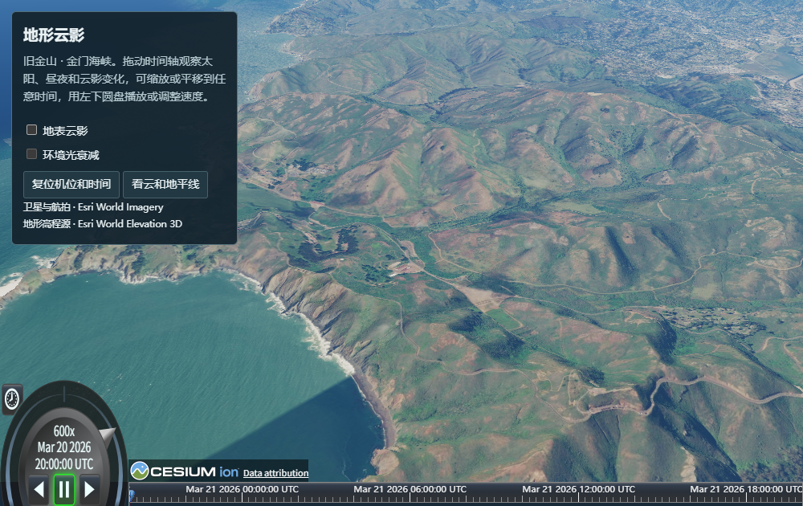
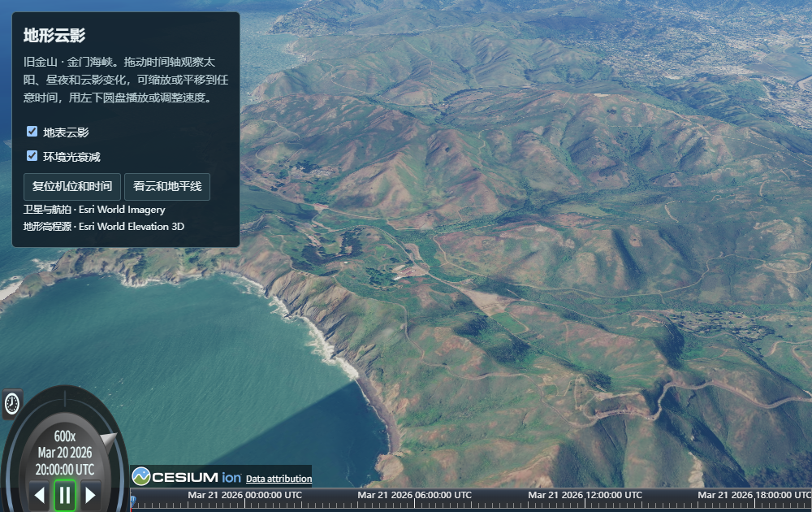

# M4 terrain receiving cloud shadows

The [Golden Gate demo](../../../../Apps/WebGPUCloudShadows.html) renders live Esri World Elevation 3D meshes with World Imagery. At a fixed time, turn off **环境光衰减** to leave only the direct-light shadow, then turn off **地表云影** to remove both. The native Cesium timeline and animation dial share the scene clock.

The lighting pass starts each ray at the terrain point reconstructed from the completed globe depth. Both the solar ray and the local zenith ray integrate the active M3 density field. The zenith column approximates obscured skylight and can remove up to 60% of the existing daytime ambient fill. Its influence fades at twilight, preserving the night floor.

| All cloud attenuation off | Only direct attenuation | Direct and ambient attenuation |
| --- | --- | --- |
|  |  |  |

## Physical GPU checks

Chromium 156.0.8078.4, Intel Xe-LPG, WebGPU hardware mode. The reports identify the tested bundle beginning with `d530259b`.

- [Live demo](live-demo.json). The 15 drawn terrain meshes spanned −2.53 to 785.12 m. With live imagery and fixed time, direct attenuation darkened 220,041 pixels, maximum difference 48 display levels. Isolating ambient attenuation darkened 103,862 pixels, maximum difference two levels. Neither comparison had a brighter pixel. Restoring the controls reproduced the view. Comparing the shadow-on/off signal at the start and [90 seconds later](live-motion.json) showed stronger shade at 202,812 sampled pixels and weaker shade at 118,538. [Terrain and clouds at the horizon](horizon.png).
- [Offline production terrain fixture](terrain-fixture.json). A deterministic heightmap supplied real meshes crossing an L8 tile boundary. The shadow signal at the seam matched the neighboring-column p95 to one display level in the daytime air view. The shadow moved in 90 s. At 9.35° solar elevation both direct and ambient attenuation darkened the ground. Hidden clouds, zero coverage, disabled surface lighting, night, 300 km orbit and terrain above the entire low cloud layer gave exact neutral controls. The artificial relief isolates geometry and lighting independently of the online DEM.
- [Ellipsoid fixture](ellipsoid-regression.json) and [three native WebGL reference views](webgl-smoke.json) passed on the same bundle. This run covers one GPU and does not measure frame cost.

To replay, build and serve the checkout, set `M1_BASE_URL` to the local URL and run `node coordination/ci/m4-terrain-shadows-smoke.mjs`. It writes a report and matched images to `Build/m4-terrain-shadows`. The interactive demo additionally needs access to the Esri elevation service.
