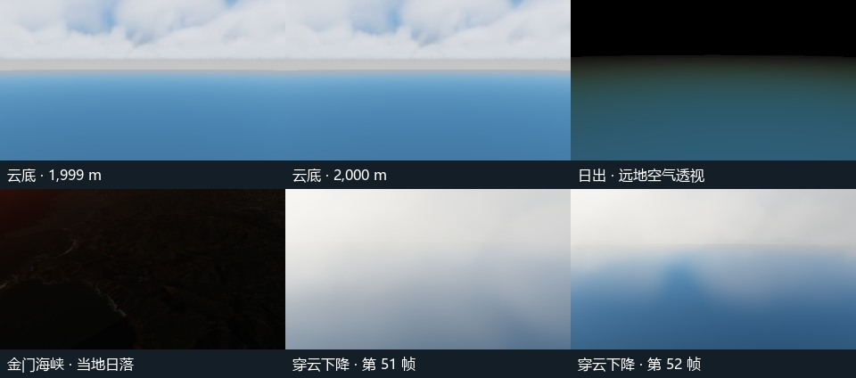

# M5 task 2 — altitude and time continuity

All eight [reference scenes](../reference-scenes/README.md) were exercised on a physical Intel Xe-LPG GPU, Chromium 156.0.8078.4. Two local discontinuities were reproduced on the unmodified reference-scene revision `18e4c8a` and corrected in `1a69ccd`. The renderer builds were isolated from concurrent cloud performance work. Baseline bundle SHA-256 starts with `3b09cc24`; the tested candidate is `f066309ab78459c00f0c39da47124062485d8f309778b8acfe934a7a5b879c15`. Reports retain the full hashes, demo hash, working-tree status and GPU identity.



## Reproduced and fixed

| Visible defect | Control and result on the same input |
| --- | --- |
| A star could disappear in one tick as the view crossed an inertial star-cell boundary. | At fixed cameras, in 1/64 s the largest star-only RGB-channel change was 186 levels at night and 143 at twilight. Tapering the point footprint at the cell face reduced those maxima to 7 and 3. Star-off controls changed by at most one level. The night frame retained 34–36 bright star pixels with peak 188–190, the twilight frame retained 21 with peak 142. [Before](stars-before/error.json) · [after](stars-after/result.json). |
| A small region inside a cloud brightened abruptly as the last sunlight left the cloud layer. | With a fixed cloud bank and stars disabled, the 78.125 ms pair at 18:15:55.629–55.707 UTC changed by up to 7 levels. The strongest 8 × 8 block averaged 2.125 levels. Blending the solar-depth contribution to ambient fill by the visible disk fraction reduced these to 1 and 0.15625. The cloud-off control stayed within one level. [Before](cloud-before/error.json) · [after](time/result.json). |

## Coverage and results

- **Height.** Holding time and orientation fixed, 605 settled camera heights produced 597 adjacent comparisons. Cloud, terrain lighting and atmospheric transport were isolated using on/off image pairs. The fixed cloud-interior view ranged from 1.2 to 320 km. The orbital view reached 37,217 km. Substantial coarse changes were bisected to distinguish parallax and changing coverage from a jump persisting at one metre. Whole-image sampled mean differences at 1,999→2,000 m and 5,999→6,000 m were 0.047 and 0.048 display levels. At 249,999→250,000 m the cloud contribution changed by zero and the displayed mean by 0.0011. The twilight fixture separately measured the enabled cirrus layer at 9 and 11 km. All eight cameras reproduced their settled images when returned to the starting pose. [Altitude report](altitude/result.json).
- **Time.** The eight fixed cameras cover 17 windows: 835 time samples in the [main report](time/result.json), 193 in the [local Golden Gate sunset](time/golden-sunset.json) and 63 in the [distant-terrain sunrise](time/distant-air.json). These include solar-limb crossings, a frozen cloud bank, wind-angle wrap, the three-minute evolution cycle, the Julian day boundary, and both direct and ambient attenuation. The distant-terrain control excluded sky and nearby receivers: toggling atmosphere changed the output over a region of 37,637 terrain pixels farther than 20 km. At Golden Gate, 20 minutes before the local sunset crossing, the direct and ambient controls affected 54,066 and 13,050 pixels respectively. Both were neutral 20 minutes after the crossing.
- **Height and time together.** The real demo replayed all 61 poses from 90 km to 1.7 km, advancing one simulated second per pose. The largest difference was [pose 51](flight/flight-51.png) to [pose 52](flight/flight-52.png), moving through the cloud from 3,083 m to 2,886 m. The mean maximum-channel difference of 42.19 display levels across the whole step fell to at most 1.02 across its 64 substeps. This is a resolved transition through the bank. [Flight report](flight/result.json).
- **Compatibility.** The existing [Moon/star suite](regression/space.json), [eight reference-scene replay](regression/references.json) and [three WebGL reference views](regression/webgl-smoke.json) passed on the candidate. The task 1 orbit, sunrise, cloud-sea, inside-cloud, Golden Gate and initial flight captures matched exactly on this host. Twilight and night reflect the intended shader changes. Golden Gate uses live Esri data; future tile content can differ.

This completes M5 task 2 for the tested scenes, sampled trajectories and adapter. A16 full motion-stability acceptance, A17 soak and recovery, profiling, and the A18 final WebGL gate remain separate. The archived PNGs are selected comparisons; the scripts generate the full set in their output directories.

## Reproduce

Build and serve the checkout, set `M1_BASE_URL` to the server and use a physical headed browser. Run the following from the repository root:

```sh
node coordination/ci/m5-altitude-continuity.mjs
node coordination/ci/m5-time-continuity.mjs
node coordination/ci/m5-star-continuity.mjs
node coordination/ci/m5-flight-continuity.mjs
```

Use `M5_TIME_CASE=cloud-sunset`, `golden-sunset` or `sunrise-distant-air` to isolate a time window. `M5_ALTITUDE_SCENE` selects an individual height scene. The before reports contain intentional failed assertions from the baseline.
