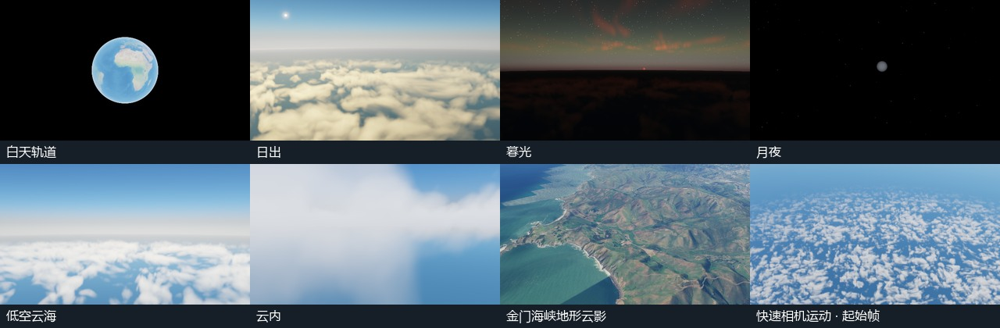
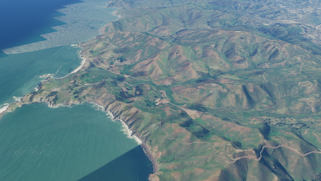
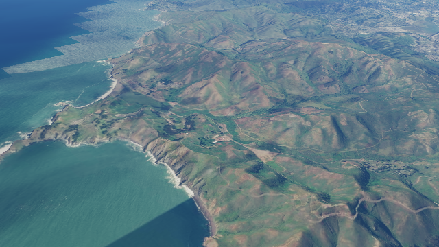

# M5 reference scenes

Open the [scene index and individual starting views](../../../../tasks/M5.md#reference-scenes). Each preset fixes its UTC time, position, orientation, field of view and cloud settings. Reset restores that state. This packet covers task 1 of M5.

## Golden Gate terrain shadow

The M4 view uses longitude −122.489°, latitude 37.8113°, height 1,900 m, heading 313° and pitch −28° at 2026-03-20 20:00 UTC. Esri World Elevation 3D supplies the real terrain and World Imagery supplies satellite imagery. The reference exposes the same direct-shadow and ambient attenuation controls as the [accepted M4 terrain capture](../../M4/final-acceptance/README.md). [Full page with source labels and attribution](golden-gate-demo.png).

| Shadows off | Direct only | Direct and ambient |
| --- | --- | --- |
|  |  |  |

The run received 77 successful elevation tile responses and 456 imagery tile responses. Direct attenuation darkened 143,598 pixels and ambient attenuation darkened another 66,387 at 640 × 360. Reset reproduced the original frame after tile loading settled. Keep the archived images for comparisons because the live Esri tiles can change. All seven other presets use local assets.

## Replay and verification

The [physical GPU report](result.json) records each camera, solar elevation, UTC, source status and image hash, plus the bundle and example hashes captured during the run. Chromium 156.0.8078.4 on Intel Xe-LPG reproduced all eight settled frames after reset. The Sun was at +4.87° at sunrise and −2.65° at twilight. Disabling clouds altered 92,062 pixels in the cloud-sea view and 190,615 pixels inside cloud.

The rapid path descends from 90 km to 1.7 km across 61 poses. The test observed frame indices 0–60 during normal playback and verified that the displayed UTC matched the submitted scene time. Replaying the same manual step reproduced its image. [Start](rapid-motion.png) · [intermediate step](rapid-motion-step.png) · [end](rapid-motion-end.png).

Serve the built checkout, set `M1_BASE_URL` to the local server and run `node coordination/ci/m5-reference-scenes-smoke.mjs`. The suite checks local assets for the seven offline views and requires successful Esri elevation and imagery responses for Golden Gate. The reference run establishes inputs for later flicker, soak, performance and release checks.
